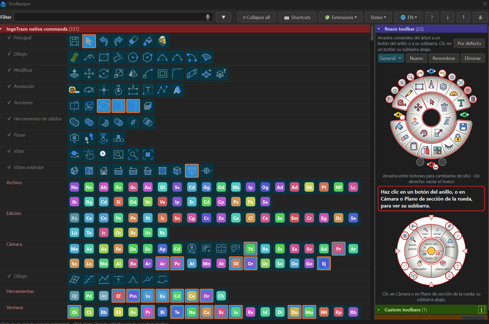
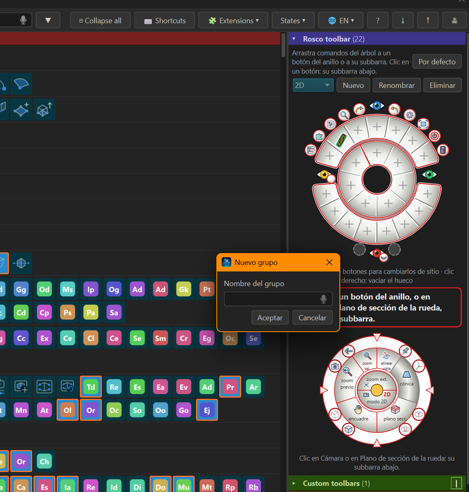

# Toolkeeper

Gestor de barras de herramientas para IngeTrazo: árbol con todos los comandos de IngeTrazo y de las extensiones, barras personalizadas, comandos personales, estados de las barras, conjuntos de extensiones y lista de atajos, en español, inglés y francés.

Toolbar manager for IngeTrazo: a tree with every IngeTrazo and extension command, custom toolbars, personal commands, toolbar states, extension sets and a shortcut list, in Spanish, English and French.

Extensión para [IngeTrazo](https://ingetrazo.com). Versión 2.6.0.

## Capturas / Screenshots

Gestor de barras, con el anillo de Rosco y la rueda de zoom. / Toolbar manager, with Rosco's ring and zoom wheel.

Grupo nuevo para el anillo de Rosco. / New group for Rosco's ring.

## Instalar

En IngeTrazo: **Extensiones ▸ Administrar extensiones**. También puedes copiar la carpeta `Toolkeeper` del zip de la última versión a `%APPDATA%\IngeTrazo\plugins\` y reiniciar IngeTrazo.

Al actualizar desde la 1.0.0 se conservan tus barras, tus comandos personales y tus ajustes.

## Install

In IngeTrazo: **Extensions ▸ Manage extensions**. You can also copy the `Toolkeeper` folder from the latest release zip to `%APPDATA%\IngeTrazo\plugins\` and restart IngeTrazo.

Updating from 1.0.0 keeps your toolbars, personal commands and settings.

Licencia / License: GPL-3.0-or-later.